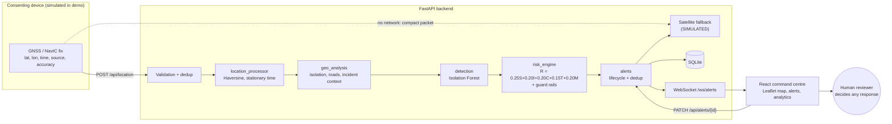

# SENTINEL
**Satellite-Enabled AI Surveillance and Emergency Location Intelligence System**
ASTRA 2026 · VIT Bhopal University · Domain 04: Satellite Communication, Navigation & Connectivity

SENTINEL is a **decision-support** tool. It flags *unusual stationary location patterns* for a human reviewer. It does not claim a stationary device means a crime, never dispatches anyone automatically, and only processes consenting, pseudonymous devices.

## 1. Problem statement
Someone in need of help in an isolated area (an accident, a medical emergency, a possible incident) can go unnoticed for hours because nobody knows to look. Responders need a way to notice "this consenting device has not moved for a long time somewhere remote" without drowning in false alarms from people who are simply at home or at work.

## 2. Proposed solution
Consenting devices share GNSS/NavIC-sourced positions. SENTINEL detects long stationary periods, adds geographic context (isolation, road access, historical incident context, time of day), scores the pattern with an explainable formula plus an Isolation Forest, and raises an alert only when several independent indicators agree. A reviewer then acknowledges, reviews, dismisses or resolves it.

## 3. Architecture


## 4. Core features
Live map with zones and device trails · four-device simulation through the real engine · explainable risk breakdown per alert · human review workflow (acknowledge, review, dismiss, resolve, welfare-check record) · WebSocket live updates · satellite-fallback simulation with queue and retry · built-in false-positive test suite · configurable thresholds · reset/repeatable demo.

## 5. Technology stack
React, Vite, Tailwind, React-Leaflet (OpenStreetMap), Recharts, Axios, Lucide · Python, FastAPI, SQLAlchemy, Pydantic, SQLite, WebSockets · scikit-learn, NumPy, pandas · GeoPandas, Shapely, GeoJSON.

## 6. AI/ML methodology
* **Stationary detection:** Haversine distance; a device is stationary when every recent fix stays within a radius (default 30 m) for a duration (default 30 min). Below that, a device is *not scored at all*.
* **Isolation Forest** (200 trees) over six features: stationary duration, movement frequency, isolation score, distance from roads, incident-context score, time-of-day score. Trained on a **synthetic** baseline of everyday behaviour (commuting, long dwell at home/work at any hour, short rural stops, a few rare remote dwells). It also trains on tiny datasets by topping up with the synthetic baseline.
* **Explanations:** per-feature contribution by occlusion (how much the anomaly score drops when a feature is set to the baseline median).
* **Risk score:** `R = 0.25S + 0.20I + 0.20C + 0.15T + 0.20M`, all inputs 0–100 (M is the Isolation Forest score).
* **Levels (demonstration thresholds, not crime probabilities):** 0–39 Normal · 40–69 Review required · 70–100 High-priority human verification.
* **Guard rails:** unless isolation (I) or the ML anomaly (M) is elevated (≥50), the score is capped at 39. High priority needs at least two of I, C, M elevated. Time of day and incident history only amplify. So stationary time, night-time, or a "crime zone" alone can never raise an alert.

| Scenario | Result |
|---|---|
| A. Moving in a populated area | Not evaluated |
| B. Stationary, populated | Normal (also at 01:00, also inside an incident-history area) |
| C. Stationary, isolated | Review required |
| D. Stationary, isolated + incident context | High-priority verification |

## 7. Space-tech integration (what is real and what is not)
| Component | Status |
|---|---|
| API accepts GNSS/NavIC-sourced coordinates with source, accuracy and timestamp | **Real** (software) |
| Detection, geospatial analysis, scoring, alerting | **Real** |
| Location feed in the demo | **Simulated** (4 scripted devices) |
| Satellite emergency messaging: queue, pass windows, exponential-backoff retry | **Simulated.** Logic is real, the link is a timer model. No satellite is contacted |
| NavIC-capable receiver in a phone or module | **Future hardware** |
| Satellite imagery for settlement/terrain analysis | **Future data.** Not used; zones are simulated |

*Contribution of NavIC/GNSS:* an independent, accuracy-tagged position source (NavIC is India's regional constellation) improves positioning in the region and lets SENTINEL weigh fix quality. *Contribution of satellite messaging:* when cellular is down, which is exactly when remote-area incidents matter, a short (≤64-byte) packet can still reach responders on supporting hardware.

## 8. Data sources and limitations
* `data/*.csv`, `data/geographical_zones.geojson` are **simulated** (Bhopal outskirts demonstration area), regenerated by `python data/generate_data.py`. Roads, settlements and "incident-history" zones are **not** real, surveyed or real incident data, and no real people or incidents are represented.
* The model is trained on synthetic data; it has no validated accuracy. Thresholds are demo values.
* Map tiles come from OpenStreetMap in the browser (internet needed).
* Not for operational use without real data, privacy review, legal basis, and consent infrastructure.

## 9. Installation (Windows, PowerShell)
Requires Python 3.10–3.12 and Node.js 18+.
```powershell
cd SENTINEL
python -m venv .venv
.\.venv\Scripts\Activate.ps1
pip install -r backend\requirements.txt
copy .env.example .env

cd frontend
npm install
```
**Backend** (terminal 1, venv active): 
```powershell
cd backend
uvicorn main:app --reload --port 8000
```
**Frontend** (terminal 2): `cd frontend` then `npm run dev` → http://localhost:5173
**API docs:** http://localhost:8000/docs

**Troubleshooting**
* *Script execution blocked:* `Set-ExecutionPolicy -Scope Process Bypass`.
* *Dashboard says backend unreachable:* start the backend first; it must be on port 8000 (the Vite dev server proxies `/api` and `/ws`).
* *GeoPandas install fails:* upgrade pip (`python -m pip install -U pip`) and use Python 3.11 or 3.12 for prebuilt wheels.
* *Map is grey:* tiles need internet access.
* *Port in use:* change `--port` and the proxy targets in `frontend/vite.config.js`.
* *Tests:* `python -m pytest tests -q` from the project root (36 tests).

## 10. Demo instructions
1. Open http://localhost:5173 and press **Start simulation** (top bar). It resets old demo data first, so it can be repeated.
2. Go to **Live Location Monitoring**. Four devices appear; click markers for evidence.
3. After about 9 seconds (simulated minute 30) two alerts appear: DEV-C3 (review) and DEV-D4 (high priority). DEV-B2 is stationary too but stays normal.
4. Open **Emergency Alerts**: see the reasons and the score breakdown, add a note, tick the welfare-check box, and press Acknowledge / Review / Dismiss / Resolve. Use **View on map** to jump to the location.
5. **AI Analytics** shows feature contributions and the 7-case false-positive suite. **Satellite Connectivity**: click *Simulate network outage*, run the simulation again, and watch packets queue, retry and transmit.

## 11. API
`POST /api/location` · `GET /api/devices` · `GET /api/alerts` · `GET|PATCH /api/alerts/{id}` · `GET /api/statistics` · `GET /api/zones` · `GET /api/analytics` · `GET /api/health` · `GET /api/connectivity` · `POST /api/connectivity/network` · `GET|PUT /api/settings` · `POST /api/simulation/start|stop|reset` · `GET /api/simulation/status` · `WS /ws/alerts`. Events: `alert_created`, `alert_updated`, `device_update`, `simulation_status`, `connectivity`, `reset`. Full schemas at `/docs`.

## 12. Future scope
Real OSM road/settlement extracts and land-cover from satellite imagery; a mobile client with explicit consent flows and on-device NavIC/GNSS; real satellite-messenger integration; labelled data to validate the model; reviewer roles and audit logging; privacy-preserving storage and retention limits.
